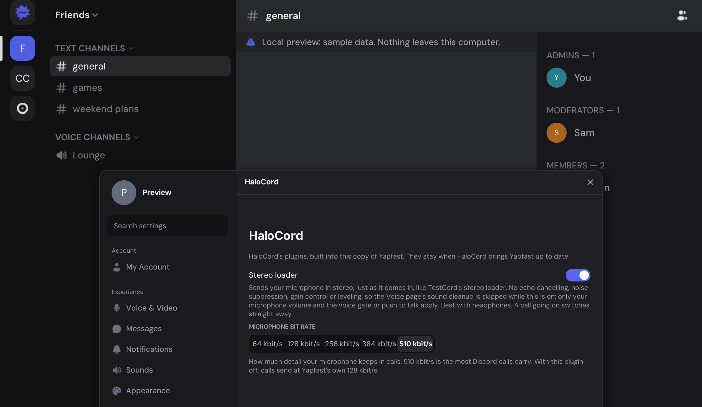
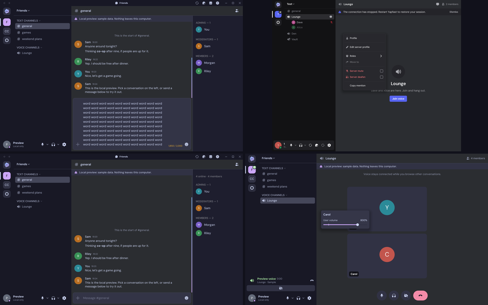
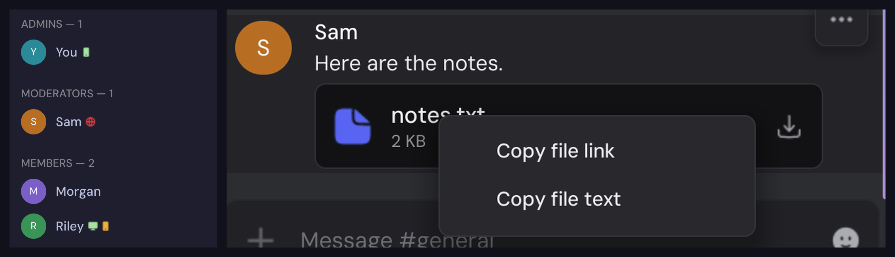
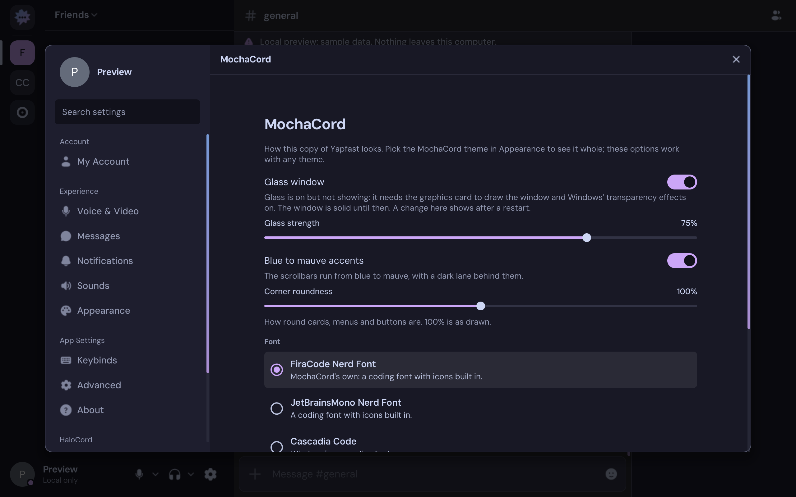
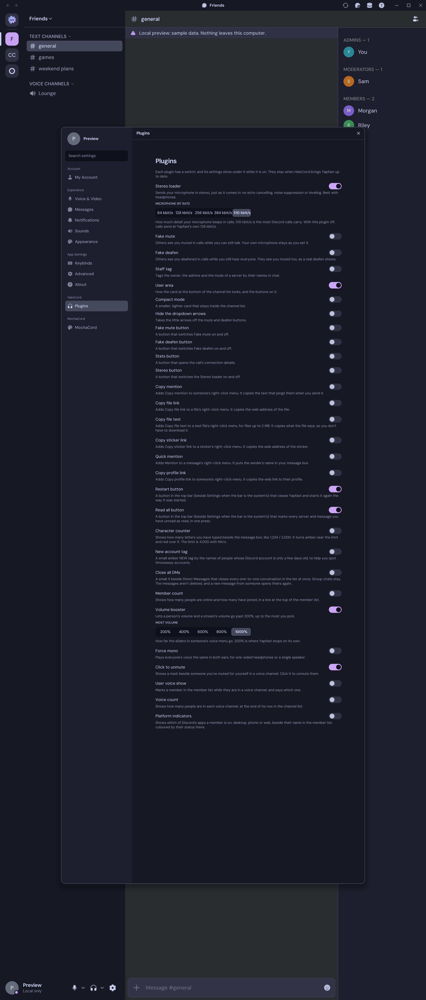

<div align="center">



# HaloCord for Yapfast

**HaloCord's voice plugins, built into Yapfast, the light Discord client written in Rust.**

The next HaloCord: 23 plugins, from stereo 510 kbit/s calls and a 1000% volume booster to copy rows, counters and quick buttons, plus the MochaCord glass theme.

<a href="https://github.com/DavidHiFi/HaloCord-Yapfast/releases/latest">

</a>

<br><br>


</div>

---

## Installation

1. Download the `HaloCord-Yapfast` ZIP from the [latest release](https://github.com/DavidHiFi/HaloCord-Yapfast/releases/latest) and extract the whole thing.
2. Close Yapfast if it's open.
3. Double-click `yapfast.exe`. The ZIP isn't code signed, so Windows SmartScreen may warn you. Choose **More info**, then **Run anyway**.
4. New to Yapfast? Link your account with the QR code. Already use it? You stay logged in.
5. Find **Plugins** and **MochaCord** at the bottom of Settings.

To build it yourself, see "Building from source" below.

## Features

### Voice

- **Stereo loader:** sends your microphone in stereo, just as it comes in. Echo cancelling, noise suppression, gain control and leveling are skipped, so only your mic volume and the voice gate or push to talk apply.
- **Bit rate:** pick 64, 128, 256, 384 or 510 kbit/s. It changes live, mid-call.
- **Off switch:** turn the plugin off and calls go back to Yapfast's own sound cleanup at 128 kbit/s.
- **Volume booster:** a person's volume and a stream's volume go past 200%, up to 1000%. You pick the top.
- **Force mono:** everyone's voice plays the same in both ears, for one-sided headphones or a single speaker.
- **Click to unmute:** a mark beside anyone you muted for yourself in a voice channel. Click it to unmute them.
- **Voice count:** how many people are in each voice channel, at the end of its row.
- **User voice show:** a mark in the member list beside anyone in a voice channel, saying which one.

### Privacy

- **Fake mute:** everyone in the call sees you muted while your microphone keeps working for you.
- **Fake deafen:** everyone sees you deafened while you still hear the call.

### Chat

- **Staff tag:** owner, admin and mod tags next to names in chat, with an optional crown and role colour.
- **Character counter:** how many letters you've typed, like 1,234 / 2,000. It turns amber near the limit and red over it.
- **New account tag:** a small NEW tag by people whose account is only a few days old (7, 14 or 30, your pick).
- **Member count:** how many people are online and how many have joined, at the top of the member list.
- **Platform indicators:** small desktop, phone and web marks beside people in the member list, coloured by their status on each. Point at one to read it.
- **Close all DMs:** one X beside Direct Messages closes every one-to-one chat in the list. Group chats stay, and nothing is deleted.

### Right-click menus

- **Copy mention:** copies the text that pings someone.
- **Copy profile link:** copies the web link to someone's profile.
- **Copy file link** and **Copy sticker link:** copy the web address of a file or sticker.
- **Copy file text:** copies what a text file says (notes, logs, code, config files up to 2 MB) straight from its menu.
- **Quick mention:** puts the sender's name in your message box from a message's menu.

### Top bar

- **Restart button:** closes Yapfast and starts it again.
- **Read all button:** marks every server and message read in one press.

### User area

- **Compact mode:** a shorter user area that stays clear of the server list.
- **Hide the arrows:** drops the little dropdown arrows beside mute and deafen.
- **Extra buttons:** HaloCord's quick buttons, like fake mute and fake deafen, sit next to settings.





### MochaCord theme



- **Glass window:** Catppuccin Mocha over a frosted, blurred window, with a strength slider.
- **Blue to mauve:** the accent and the scrollbars run from blue to mauve.
- **Title bar room:** space above the home button for the native Windows title bar.
- **Your font:** pick the font, weight and corner roundness. FiraCode Nerd Font Medium by default.
- **New icon:** a riced app and home icon.

### Plugins




- **Plugins tab:** its own section in Settings, one switch per plugin, a search box, and each plugin's settings under it.
- **Your call:** most plugins start off. The stereo loader, user area, volume booster, click to unmute and the two top bar buttons start on, as they were in HaloCord.
- **Survives updates:** HaloCord's code lives in its own files, with small hooks into Yapfast, so it moves onto each new Yapfast release with little fuss.

## Notes

> [!IMPORTANT]
> **Early days.** Every plugin here is new. If something looks off, turn that plugin off in the Plugins tab and open an issue.

> [!NOTE]
> **Replacing the old HaloCord.** The Electron-based [HaloCord](https://github.com/DavidHiFi/HaloCord) is retired. This repo is where HaloCord carries on.

> [!WARNING]
> **Updates come from here.** An update Yapfast itself offers is the stock app, without HaloCord. Wait for the next HaloCord release instead.

<details>
<summary><b>Building from source</b></summary>

<br>

On Windows, from the project folder:

```powershell
$env:YAPFAST_RELEASE = "1"
cargo build --locked --release --target x86_64-pc-windows-msvc --no-default-features --features desktop,discord
```

Rust 1.97.1 installs itself from `rust-toolchain.toml`. The first build is big and takes a while.

Close Yapfast, then copy `target\x86_64-pc-windows-msvc\release\yapfast.exe` over the one in `%LOCALAPPDATA%\Programs\Yapfast`.

Yapfast's own guide covers the Nix route and Linux: see the [main README](../README.md#build-it-yourself). Every hook HaloCord adds to Yapfast's files is listed in [docs/halocord.md](../docs/halocord.md).

</details>

## Contributing

Bug reports with steps to repeat them help most, and so do plugin ideas.

<a href="CONTRIBUTING.md">

</a>

## Star history

Thanks to everyone who followed HaloCord over here.

<a href="https://www.star-history.com/?repos=DavidHiFi%2FHaloCord-Yapfast&amp;type=date">
  <picture>
    <source media="(prefers-color-scheme: dark)" srcset="https://api.star-history.com/chart?repos=DavidHiFi/HaloCord-Yapfast&amp;type=date&amp;theme=dark&amp;legend=top-left" />
    <source media="(prefers-color-scheme: light)" srcset="https://api.star-history.com/chart?repos=DavidHiFi/HaloCord-Yapfast&amp;type=date" />
    
  </picture>
</a>

## Credits

- **Author:** Myself, [DavidHiFi](https://github.com/DavidHiFi)

| Who | What |
|---|---|
| **Yapfast** ([yapfast/yapfast](https://github.com/yapfast/yapfast)) | The whole client. HaloCord adds its plugins on top. |
| **SickoHours** ([SickoHours](https://github.com/SickoHours)) | Contributor: 45 pull requests of plugins and fixes, among them sticker links, staff and platform marks, Auto zipper, Timestamp picker, Universal mention, Song link, Favorite anything, Message logger ignore lists, the More buttons tray, Custom user colours, Better user tools and Show badges in chat. |
| **TestCord** ([Codeberg](https://codeberg.org/Testcord/testcord)) | The stereo loader idea, from TestCord's plugin of the same name. |
| **Vencord** ([vencord.dev](https://vencord.dev)) and **Equicord** ([Equicord/Equicord](https://github.com/Equicord/Equicord)) plugin authors | The ideas behind the copy rows, quick mention, character counter, new account tag, member count, close all DMs, voice count and user voice show. |
| **Discord Userdoccers** ([docs.discord.food](https://docs.discord.food)) | The Discord documentation Yapfast is built from. |

Built on [Rust](https://www.rust-lang.org), with [iced](https://iced.rs) and [Opus](https://opus-codec.org).

> Missing or wrong credit? [Open an issue](https://github.com/DavidHiFi/HaloCord-Yapfast/issues/new) and I'll fix it.

## Disclaimers

Most of HaloCord's code in this repo was developed with AI coding agents, mainly Claude Code. No single AI agent made the project.

Yapfast is free software under the GNU General Public License, version 3 or later, and so is this copy. This repo is not the official Yapfast. Report HaloCord problems here, not to Yapfast.

<div align="center">
<br>
<sub>Not affiliated with Discord or the Yapfast project. Requires a Discord account.</sub>
</div>
